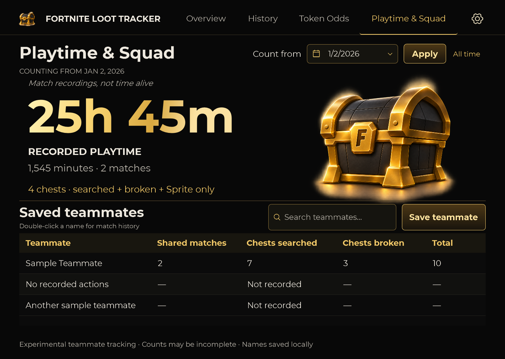

# Fortnite Chest Counter

Count the chests you search or break in Fortnite. The tracker reads your saved replays and updates your totals after each recorded match.

[**Download for Windows (.exe)**](https://github.com/frogo084/Fortnite-Chest-Counter/releases/latest/download/Fortnite-Chest-Counter.exe) · Windows x64 · No installer or separate .NET download



*Example with fictional data: Sample Teammate has 7 chests searched and 3 broken, for 10 recorded chest actions.*

## Get started

1. Download `Fortnite-Chest-Counter.exe` using the link above and open it.
2. Enable replay recording in Fortnite if it is off.
3. Keep the tracker open while you play. It finds Fortnite’s default replay folder automatically. If you use another folder, choose it in the tracker’s Settings.

## What it tracks

- Regular and Sprite chests searched or broken, plus other recorded containers such as ammo boxes.
- Match history, recorded playtime, and totals from a date you choose.
- Pirate Token odds using your replay counts or numbers you enter.
- **Experimental teammate tracking.** Save a teammate’s name in Playtime & Squad and double-click it to see shared matches. The tracker counts actions it can attribute from your saved replays. “Not recorded” means the replay did not show an attributable action; it does not establish that the teammate opened zero chests.

## Privacy

Your replays, saved teammate names, preferences, and match history stay on your PC. The tracker reads replays from disk and stores its own history under `%LOCALAPPDATA%\FortniteLootTracker`.

## Build from source

Use the .NET 10 SDK on Windows:

```powershell
dotnet publish Source/FortniteLootTracker.csproj -c Release -r win-x64 --self-contained true -o App -p:PublishSingleFile=true -p:IncludeNativeLibrariesForSelfExtract=true -p:DebugType=None -p:DebugSymbols=false
```

Unofficial fan-made app. Third-party notices: [Replay parser](PARSER-LICENSE.txt), [Phosphor icons](PHOSPHOR-LICENSE.txt), [font](FONT-LICENSE.txt), and [.NET](DOTNET-NOTICES.txt).
